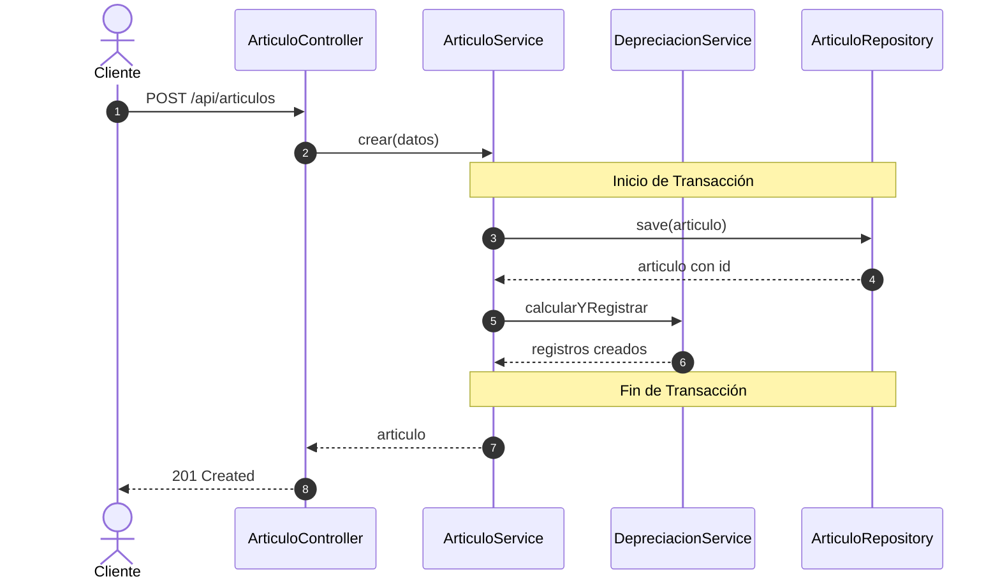
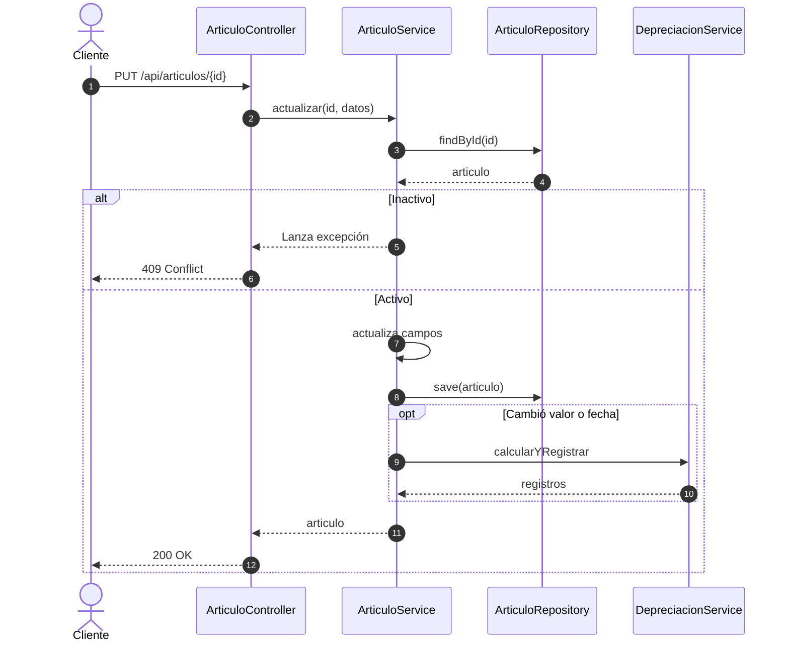
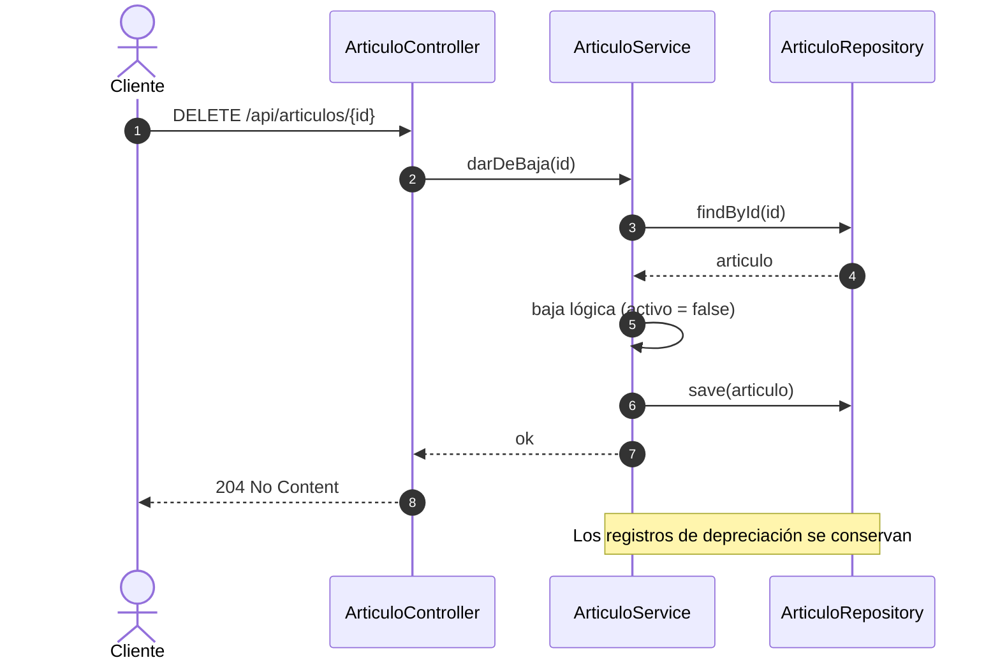
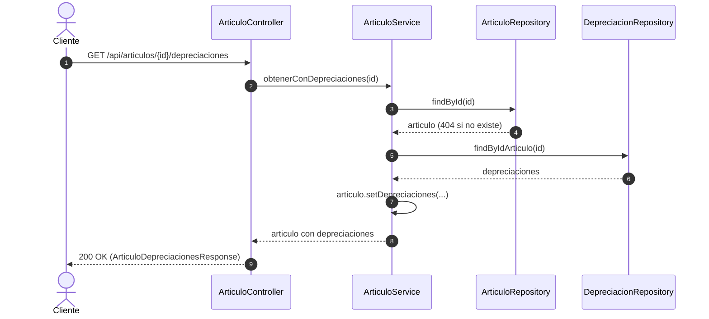
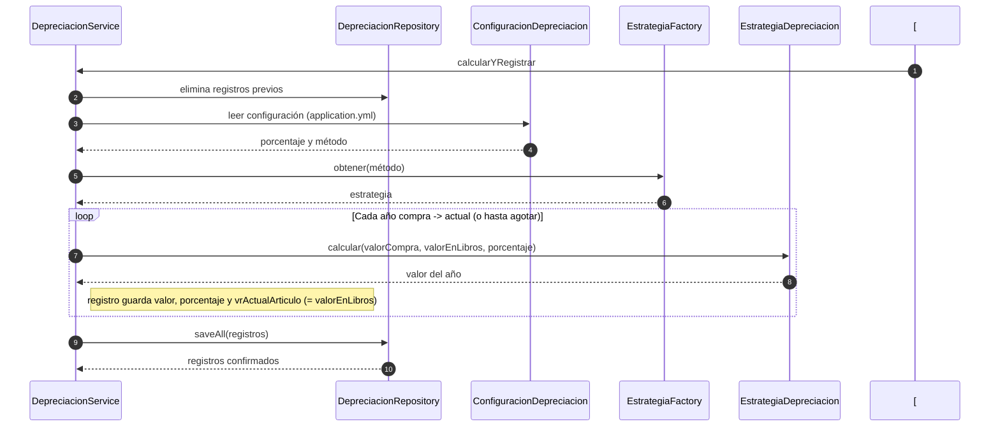

# Documentación Técnica: Sistema de Depreciación de Artículos

Esta documentación consolida el diseño del sistema, los modelos de datos, la arquitectura de componentes y los flujos de secuencia para la gestión de artículos y el cálculo de su depreciación.

---

## 1. Modelo de Datos y Clase (Diagrama de Clases)

El modelo conceptual define una relación de un artículo con sus respectivos registros anuales de depreciación (**1 a N**). En el dominio, `Articulo.depreciaciones` modela esa relación (solo se carga al consultar el artículo con sus depreciaciones). Los importes son `BigDecimal` con 2 decimales.

La configuración de depreciación (porcentaje y método) **no es una entidad persistida**: viene de `application.yml`.

```
 +----------------------------------+            +----------------------------------+
 |             Articulo             |            |       DepreciacionArticulo       |
 +----------------------------------+            +----------------------------------+
 | + idArticulo: Integer            |            | + id: Integer                    |
 | + nombre: String                 |            | + idArticulo: Integer            |
 | + serial: String                 | 1     1..N | + ano: integer                   |
 | + descripcion: String            +------------+ + valor: BigDecimal              |
 | + fechaCompra: LocalDate         |            | + porcentaje: BigDecimal         |
 | + valorCompra: BigDecimal        |            | + vrActualArticulo: BigDecimal   |
 | + activo: boolean                |            +----------------------------------+
 | + depreciaciones: List           |            | + get(): type                    |
 +----------------------------------+            | + set(type): void                |
 | + get(): type                    |            +----------------------------------+
 | + set(type): void                |
 +----------------------------------+
```

### Diccionario de Datos

#### Entidad: `Articulo`
| Campo | Tipo | Descripción |
| :--- | :--- | :--- |
| **idArticulo** | Integer | Identificador único del artículo. |
| **nombre** | String | Nombre descriptivo del artículo. |
| **serial** | String | Código alfanumérico asignado por el fabricante o cliente. |
| **descripcion** | String | Texto con la descripción y características del artículo. |
| **fechaCompra** | Date | Fecha en la cual se adquirió el artículo. |
| **valorCompra** | BigDecimal | Costo total original de adquisición (2 decimales). |
| **depreciaciones** | List\<DepreciacionArticulo\> | Relación 1 a N con sus depreciaciones anuales (solo se carga al consultarlas). |
| **activo** | Boolean | Estado del artículo (Indica si está activo o de baja lógica). |

#### Entidad: `DepreciacionArticulo`
| Campo | Tipo | Descripción |
| :--- | :--- | :--- |
| **id** | Integer | Identificador único del registro de depreciación. |
| **idArticulo** | Integer | Clave foránea referenciando al artículo. |
| **ano** | Integer | Año en el cual se calculó/aplicó la depreciación. |
| **valor** | BigDecimal | Monto de la depreciación correspondiente a ese año. |
| **porcentaje** | BigDecimal | Porcentaje de depreciación aplicado (0–100). |
| **vrActualArticulo** | BigDecimal | Valor en libros del artículo al inicio de ese año (el usado para calcularlo). |

---

## 2. Arquitectura de Componentes

El diseño utiliza el patrón de diseño **Strategy** junto a un **Factory** para permitir extensibilidad en las diferentes fórmulas de depreciación sin acoplar la lógica de negocio.

```
+------------------+
|   Cliente HTTP   |
+--------+---------+
         |
         v
+------------------------------------+
|         ArticuloController         |
|     (POST, GET, PUT, DELETE)       |
+--------+---------------------------+
         |
         v
+------------------------------------+          +------------------------------------+
|          ArticuloService           |--------->|         DepreciacionService        |-----> [ConfiguracionDepreciacion]
|              (CRUD)                |          |        (Calcula y registra)        |
+--------+---------------------------+          +----+--------------------------+----+
         |                                           |                          |
         v                                           v                          v
+------------------------------------+    +---------------------+    +-------------------------+
|         ArticuloRepository         |    | DepreciacionRepo    |    |    EstrategiaFactory    |
+--------+---------------------------+    +----------+----------+    +------------+------------+
         |                                           |                               |
         |                                           v                               v
         |                                  +-----------------+          <<interface>>
         +--------------------------------->|  Base de Datos  |    EstrategiaDepreciacion
                                            +-----------------+               (calcular())
                                                                             /            \
                                                                            v              v
                                                                +--------------------+   +-------------------+
                                                                |     LineaRecta     |   | SaldoDecreciente  |
                                                                +--------------------+   +-------------------+
```

---

## 3. Diagramas de Secuencia (Flujos del Sistema)

### 3.1. Crear Artículo (`POST /api/articulos`)

Al crear un nuevo artículo dentro de una transacción, se almacena en la base de datos e inmediatamente se invocan los cálculos automáticos de depreciación.



---

### 3.2. Modificar Artículo (`PUT /api/articulos/{id}`)

Si el artículo está inactivo, la modificación falla lanzando una excepción (`409 Conflict`). Si cambia el valor o la fecha de compra, el sistema recalcula los registros de depreciación.



---

### 3.3. Eliminar / Dar de Baja (`DELETE /api/articulos/{id}`)

La eliminación aplica un borrado lógico (`activo = false`). Los registros históricos de depreciación **se conservan** para auditoría y trazabilidad.



---

### 3.4. Consultar Artículo con Depreciaciones (`GET /api/articulos/{id}/depreciaciones`)

Devuelve el artículo junto con su relación de depreciaciones (ordenadas por año).



---

### 3.5. Proceso Completo de Cálculo de Depreciación (`calcularYRegistrar`)

Proceso encargado de recalcular los rubros eliminando históricos obsoletos y aplicando el patrón Strategy de acuerdo a la configuración activa.

