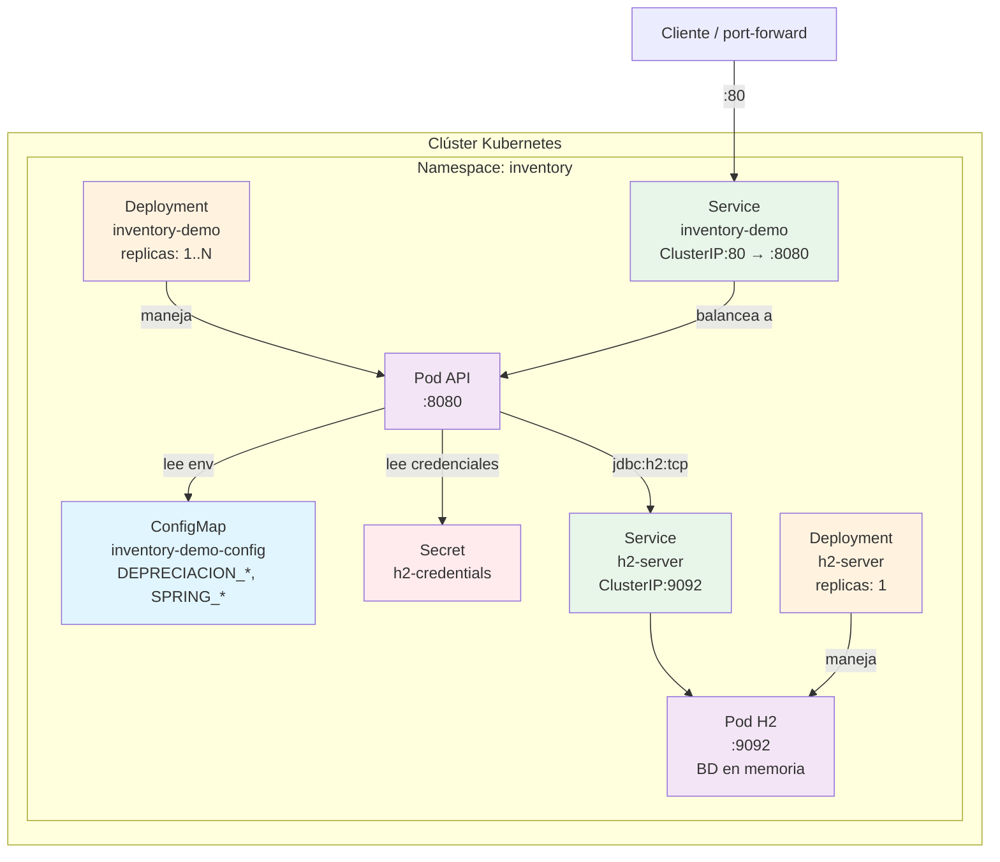

# Manifiestos Kubernetes - Explicación Detallada

Este documento explica cada archivo YAML del directorio `k8s/` utilizado para desplegar InventoryDemo en Kubernetes. Para el paso a paso, ver [despliegue-kubernetes.md](despliegue-kubernetes.md).

La solución tiene dos componentes: la **API** (`inventory-demo`) y un **servidor H2** (`h2-server`) con la base en memoria, al que la API se conecta por TCP.

---

## namespace.yaml

```yaml
apiVersion: v1
kind: Namespace
metadata:
  name: inventory
```

**Propósito**: Crea un espacio de nombres aislado en Kubernetes.

- **kind: Namespace** - Tipo de recurso
- **metadata.name: inventory** - Nombre del namespace donde viven todos los demás recursos

**Por qué es necesario**: Permite separar los recursos de InventoryDemo de otras aplicaciones en el mismo clúster. Evita conflictos de nombres y facilita la gestión de permisos. Eliminar el namespace elimina todo su contenido.

---

## h2-secret.yaml

```yaml
apiVersion: v1
kind: Secret
metadata:
  name: h2-credentials
  namespace: inventory
type: Opaque
stringData:
  username: inventario
  password: "123456"
```

**Propósito**: Guarda el usuario y la contraseña de la base de datos H2.

- **stringData** - Valores en texto plano; Kubernetes los codifica en base64 al almacenarlos
- **username / password** - Credenciales que la API usa para conectarse. H2 crea la base con ellas en la primera conexión

**Importante**:
- Los valores son de ejemplo: cámbialos fuera de un entorno de pruebas.
- Los valores de `stringData` deben ser **texto**. Una contraseña solo numérica va entre comillas (`"123456"`); sin ellas YAML la lee como número y `kubectl apply` falla con `cannot unmarshal number into Go struct field Secret.stringData of type string`.
- Base64 no es cifrado: no subas contraseñas reales al repositorio.

---

## configmap.yaml

```yaml
apiVersion: v1
kind: ConfigMap
metadata:
  name: inventory-demo-config
  namespace: inventory
data:
  DEPRECIACION_PORCENTAJE: "4"
  DEPRECIACION_METODO: "LINEA_RECTA"
  SPRING_DATASOURCE_URL: "jdbc:h2:tcp://h2-server:9092/mem:inventario;DB_CLOSE_DELAY=-1"
  SPRING_JPA_HIBERNATE_DDL_AUTO: "update"
```

**Propósito**: Almacena la configuración no sensible de la API como pares clave-valor.

- **DEPRECIACION_PORCENTAJE** - Porcentaje de depreciación anual (0 a 100)
- **DEPRECIACION_METODO** - `LINEA_RECTA` o `SALDO_DECRECIENTE`
- **SPRING_DATASOURCE_URL** - Conexión al servidor H2:
  - `h2-server:9092` - Nombre del Service de H2 y su puerto
  - `mem:inventario` - Base en memoria llamada `inventario`
  - `DB_CLOSE_DELAY=-1` - Evita que H2 borre la base cuando se cierra la última conexión (por ejemplo, al reiniciar la API)
- **SPRING_JPA_HIBERNATE_DDL_AUTO: "update"** - Con `create-drop` (valor por defecto de la app) la base compartida se borraría al apagar cualquier réplica de la API

**Por qué usar ConfigMap**: Permite cambiar la configuración sin reconstruir la imagen Docker. Las claves se inyectan como variables de entorno y Spring Boot las asocia a sus propiedades (`depreciacion.*`, `spring.datasource.url`, `spring.jpa.hibernate.ddl-auto`). Para aplicar un cambio hay que reiniciar el Deployment.

---

## h2-deployment.yaml

```yaml
apiVersion: apps/v1
kind: Deployment
metadata:
  name: h2-server
  namespace: inventory
  labels:
    app: h2-server
spec:
  replicas: 1
  strategy:
    type: Recreate
  selector:
    matchLabels:
      app: h2-server
  template:
    metadata:
      labels:
        app: h2-server
    spec:
      containers:
        - name: h2-server
          image: inventory-h2:2.2.224
          imagePullPolicy: IfNotPresent
          ports:
            - containerPort: 9092
          readinessProbe:
            tcpSocket:
              port: 9092
          livenessProbe:
            tcpSocket:
              port: 9092
```

*(Se muestra resumido; las probes tienen `initialDelaySeconds`/`periodSeconds` y hay `resources` en el archivo real.)*

**Propósito**: Ejecuta el servidor H2 en modo TCP como un pod independiente de la API.

- **replicas: 1** - Siempre una: la base vive en la memoria de ese proceso, y varias réplicas serían bases distintas
- **strategy: Recreate** - En una actualización se elimina el pod viejo antes de crear el nuevo, para no tener dos servidores H2 a la vez
- **image: inventory-h2:2.2.224** - Imagen construida con `docker compose build` (ver `docker-compose.yml`). La versión de H2 debe coincidir con la del cliente de la API (2.2.224)
- **readiness/livenessProbe: tcpSocket 9092** - Comprueba que el puerto acepta conexiones (H2 no tiene endpoint HTTP de health)
- **resources** - 100m CPU y 256Mi de memoria garantizados; máximo 512Mi de memoria

**Persistencia**: los datos están en la memoria del pod. Sobreviven a reinicios y actualizaciones de la API, pero se pierden si el pod `h2-server` se reinicia o se elimina.

---

## h2-service.yaml

```yaml
apiVersion: v1
kind: Service
metadata:
  name: h2-server
  namespace: inventory
spec:
  type: ClusterIP
  selector:
    app: h2-server
  ports:
    - port: 9092
      targetPort: 9092
```

**Propósito**: Da un nombre estable (`h2-server`) al servidor H2 dentro del clúster.

- **selector.app: h2-server** - Dirige el tráfico al pod de H2
- **port: 9092** - Puerto de H2 en modo TCP

**URL interna**: `h2-server:9092` (dentro del namespace) o `h2-server.inventory.svc.cluster.local:9092`. Es el host que aparece en `SPRING_DATASOURCE_URL`.

**Acceso desde tu máquina** (opcional, para un cliente SQL): `kubectl port-forward -n inventory svc/h2-server 9092:9092`.

---

## deployment.yaml

```yaml
apiVersion: apps/v1
kind: Deployment
metadata:
  name: inventory-demo
  namespace: inventory
  labels:
    app: inventory-demo
spec:
  replicas: 1
  selector:
    matchLabels:
      app: inventory-demo
  template:
    metadata:
      labels:
        app: inventory-demo
    spec:
      initContainers:
        - name: esperar-h2
          image: busybox:1.36
          command: ["sh", "-c", "until nc -z h2-server 9092; do echo esperando a h2-server; sleep 2; done"]
      containers:
        - name: inventory-demo
          image: inventory-demo:0.0.1
          imagePullPolicy: IfNotPresent
          ports:
            - containerPort: 8080
          envFrom:
            - configMapRef:
                name: inventory-demo-config
          env:
            - name: SPRING_DATASOURCE_USERNAME
              valueFrom:
                secretKeyRef:
                  name: h2-credentials
                  key: username
            - name: SPRING_DATASOURCE_PASSWORD
              valueFrom:
                secretKeyRef:
                  name: h2-credentials
                  key: password
          resources:
            requests:
              cpu: 250m
              memory: 384Mi
            limits:
              cpu: "1"
              memory: 768Mi
          readinessProbe:
            httpGet:
              path: /actuator/health
              port: 8080
            initialDelaySeconds: 20
            periodSeconds: 10
          livenessProbe:
            httpGet:
              path: /actuator/health
              port: 8080
            initialDelaySeconds: 40
            periodSeconds: 15
```

**Propósito**: Define cómo desplegar la API como Pods gestionados.

### Secciones clave

- **kind: Deployment** - Gestiona Pods con actualizaciones declarativas
- **spec.replicas** - Cantidad de Pods de la API. Vale 1 por defecto, pero **se puede escalar** (`kubectl scale deployment/inventory-demo -n inventory --replicas=2`) porque todas las réplicas comparten la base del `h2-server`
- **selector.matchLabels** - Selecciona Pods con label `app: inventory-demo`
- **initContainers.esperar-h2** - Se ejecuta antes que la API y espera hasta que `h2-server:9092` acepte conexiones. Evita que la API arranque y falle porque H2 aún no está listo. Descarga `busybox:1.36`
- **containers[0]**:
  - **image: inventory-demo:0.0.1** - Imagen de la API (`docker compose build`)
  - **imagePullPolicy: IfNotPresent** - Usa la imagen local si existe (necesario en un clúster local sin registry)
  - **ports.containerPort: 8080** - Puerto que expone el contenedor
  - **envFrom.configMapRef** - Inyecta todas las claves del ConfigMap como variables de entorno
  - **env (secretKeyRef)** - Inyecta usuario y contraseña desde el Secret `h2-credentials` como `SPRING_DATASOURCE_USERNAME` y `SPRING_DATASOURCE_PASSWORD`
  - **resources**:
    - **requests** - Garantía mínima: 250m CPU, 384Mi memoria
    - **limits** - Máximo permitido: 1 CPU, 768Mi memoria
  - **readinessProbe** - Verifica si el Pod está listo para recibir tráfico:
    - **path: /actuator/health** - Endpoint de health de Actuator
    - **initialDelaySeconds: 20** - Espera 20s antes del primer check
    - **periodSeconds: 10** - Verifica cada 10s
  - **livenessProbe** - Verifica si el Pod está vivo (si falla, Kubernetes lo reinicia):
    - **initialDelaySeconds: 40** - Espera 40s antes del primer check
    - **periodSeconds: 15** - Verifica cada 15s

---

## service.yaml

```yaml
apiVersion: v1
kind: Service
metadata:
  name: inventory-demo
  namespace: inventory
spec:
  type: ClusterIP
  selector:
    app: inventory-demo
  ports:
    - port: 80
      targetPort: 8080
```

**Propósito**: Expone la API como un endpoint estable dentro del clúster y reparte el tráfico entre sus réplicas.

- **spec.type: ClusterIP** - Solo accesible dentro del clúster
- **selector.app: inventory-demo** - Selecciona Pods con ese label
- **ports[0]**:
  - **port: 80** - Puerto del Service
  - **targetPort: 8080** - Puerto del contenedor al que redirige

**URL interna**: `http://inventory-demo.inventory.svc.cluster.local:80`

**Por qué ClusterIP**: Para acceso externo se usaría un Ingress o LoadBalancer. En local se accede con `kubectl port-forward`.

---

## Diagrama de Arquitectura



---

## Resumen de Relaciones

```
namespace.yaml
    ↓ Crea el namespace "inventory"

h2-secret.yaml
    ↓ Crea el Secret con usuario y contraseña de H2

configmap.yaml
    ↓ Crea el ConfigMap con DEPRECIACION_*, URL de la BD y ddl-auto

h2-service.yaml + h2-deployment.yaml
    ↓ Crean el servidor H2 (1 Pod) y su nombre estable "h2-server:9092"

deployment.yaml
    ↓ Espera a h2-server (initContainer)
    ↓ Lee el ConfigMap y el Secret como variables de entorno
    ↓ Crea los Pods de la API, que se conectan a H2 por TCP

service.yaml
    ↓ Selecciona los Pods de la API
    ↓ Expone puerto 80 → 8080
```

---

## Orden de Aplicación

El orden importa: el namespace debe existir primero, y H2 debe estar listo antes que la API.

```bash
kubectl apply -f k8s/namespace.yaml
kubectl apply -f k8s/h2-secret.yaml -f k8s/configmap.yaml
kubectl apply -f k8s/h2-service.yaml -f k8s/h2-deployment.yaml
kubectl rollout status deployment/h2-server -n inventory
kubectl apply -f k8s/deployment.yaml -f k8s/service.yaml
```

> Un `kubectl apply -f k8s/` también funciona si el namespace ya existe. El `initContainer` hace que la API espere a H2 aunque se apliquen a la vez.

---

## Comandos Útiles

```bash
# Ver recursos
kubectl get all -n inventory

# Logs de la API y de H2
kubectl logs -n inventory -l app=inventory-demo
kubectl logs -n inventory -l app=h2-server

# Descripción de un Deployment
kubectl describe deployment inventory-demo -n inventory

# Acceso local a la API
kubectl port-forward -n inventory svc/inventory-demo 8080:80

# Acceso local a H2 (cliente SQL)
kubectl port-forward -n inventory svc/h2-server 9092:9092

# Escalar la API
kubectl scale deployment/inventory-demo -n inventory --replicas=2

# Aplicar un cambio de configuración (ConfigMap o Secret)
kubectl rollout restart deployment/inventory-demo -n inventory
```
